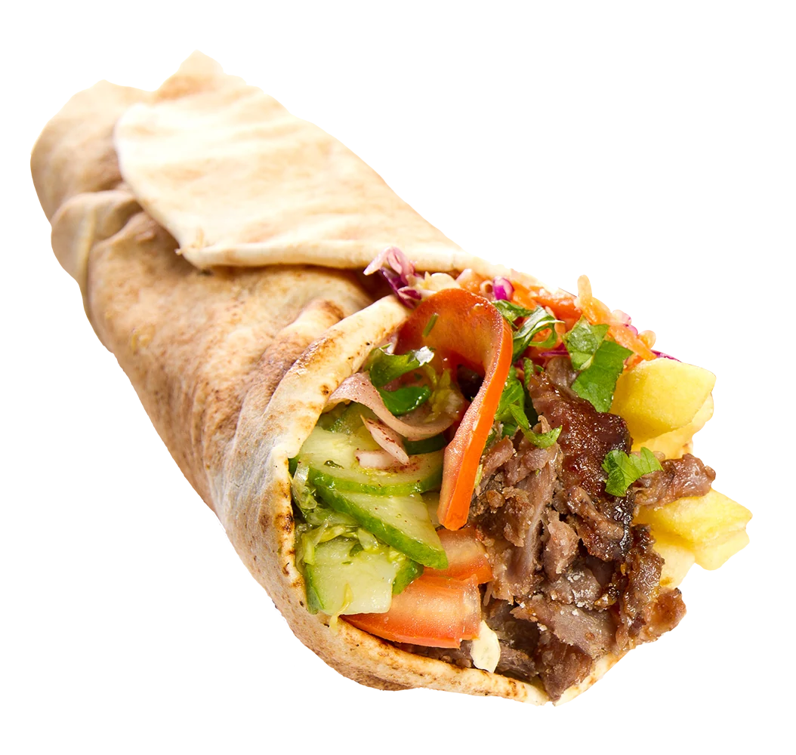
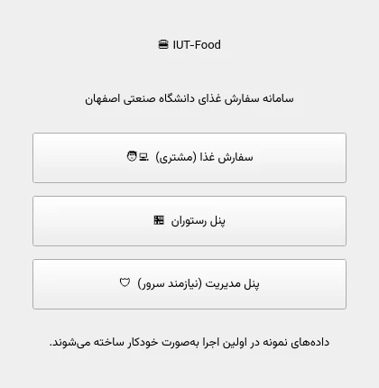
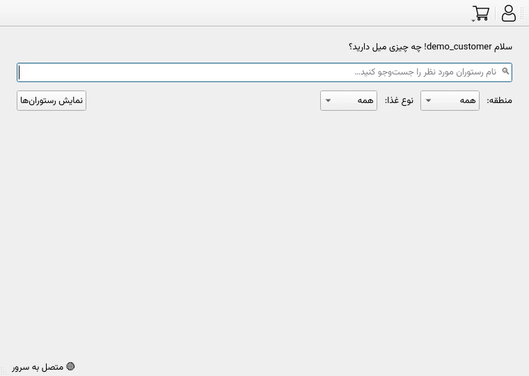
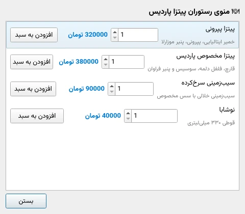
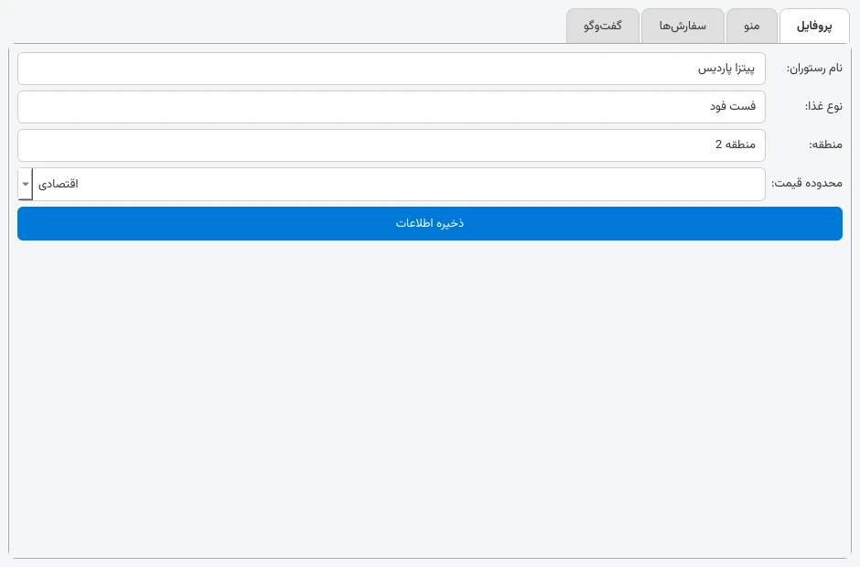
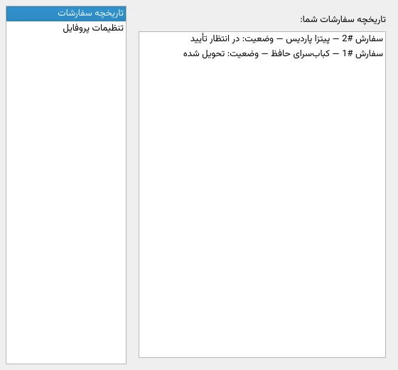
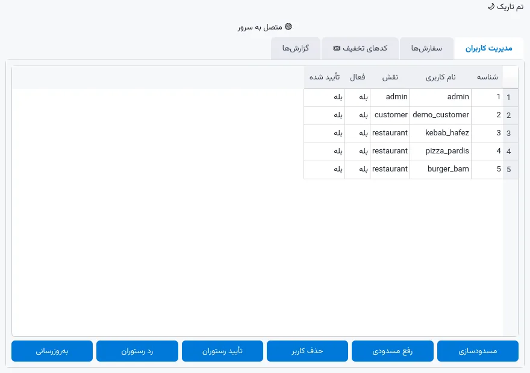
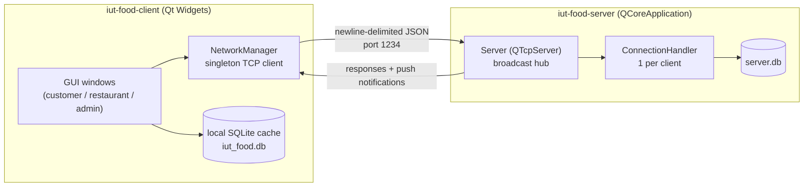
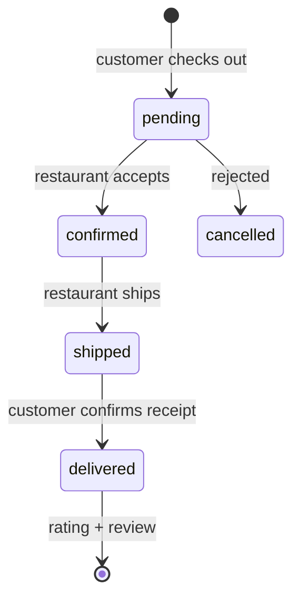
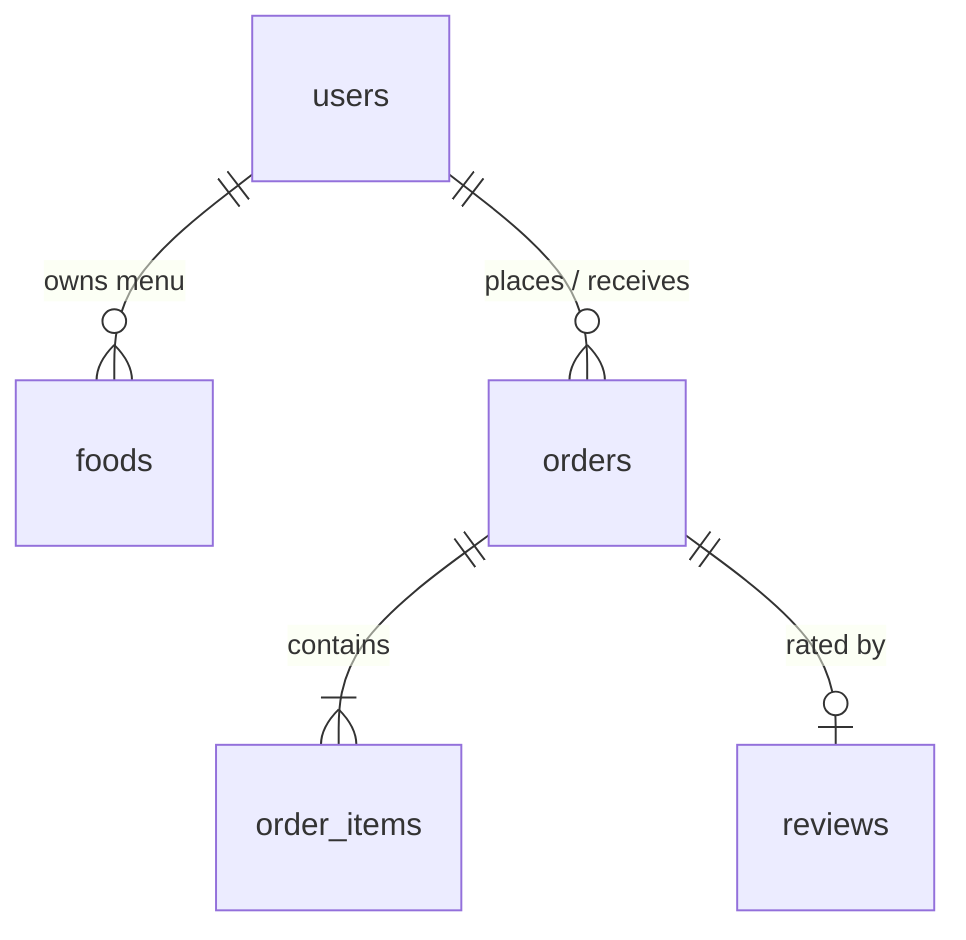

<div align="center">



# 🍔 IUT-Food

**A campus food-ordering system built with Qt / C++17 — client, TCP server and SQLite, fully working end-to-end.**

[](https://github.com/Abolfazlrwm/IUT_Food/actions/workflows/ci.yml)


*فارسی? The UI is Persian — the docs below are in English. [پایین را ببینید 👇](#-پروژه)*

</div>

---

## ✨ What is this?

IUT-Food is a food-ordering platform for university students (built as a software-engineering
course project at Isfahan University of Technology). It ships as **two Qt applications**:

| App | What it does |
|---|---|
| **`iut-food-client`** (GUI) | Customers browse restaurants, order food, chat and review. Restaurant owners manage their profile, menu and incoming orders. Admins watch over users, orders and live reports. |
| **`iut-food-server`** (console) | A TCP server (newline-delimited JSON) that owns the remote database, authenticates logins, and **broadcasts order-status changes and chat messages to every connected client in real time**. |

The client is offline-first: it keeps a local SQLite cache and degrades gracefully when the
server is not running, then syncs through the server whenever it is available.

## 🖼 Screenshots

| Launcher | Customer workspace |
|---|---|
|  |  |

| Restaurant menu & cart | Live chat + restaurant dashboard |
|---|---|
|  |  |

| Order history (Persian statuses) | Admin panel (live server data) |
|---|---|
|  |  |

## 🚀 Features

- 👤 **Customer** — search & filter restaurants, browse menus, shopping cart, checkout,
  order history, delivery confirmation, star ratings with comments, live chat per order
- 🏪 **Restaurant owner** — login/registration (admin-approved), profile editor,
  full menu CRUD, incoming-order dashboard, one-click *confirm → ship* transitions
- 🛡 **Admin** — user management (block / unblock / delete), restaurant approval workflow,
  order browser, and **four live reports** (orders by status, revenue per restaurant, most
  active restaurants, average rating per restaurant) rendered with Qt Charts
- 🔌 **Real-time server push** — status changes and chat messages are broadcast over TCP;
  every window of every process updates instantly
- 💾 **Offline-first client** — local SQLite cache; the app is fully usable without the server
- 🌱 **Self-seeding demo data** — first launch creates restaurants, menus, orders and a review,
  so every screen has content immediately
- 🎨 **Bundled Vazirmatn typeface** + full right-to-left UI — Persian renders identically on
  Windows, Linux and macOS (no more broken Tahoma)
- 🔒 Hashed passwords (SHA-256), parameterised SQL everywhere, canonical order-state machine

## 🏗 Architecture



**Order lifecycle** (canonical states, shown in Persian in the UI):



The full JSON command reference lives in [`docs/PROTOCOL.md`](docs/PROTOCOL.md).

## 🗄 Database

Six tables — `users` (customers, restaurants and admins in one table with a `role`
column), `foods`, `orders`, `order_items` (with a denormalised food-name snapshot so
history survives menu edits), `restaurants` (server-sync cache) and `reviews`
(1–5 stars + comment, one per order):



## 📦 Build

### Prerequisites

- **Qt 5.15+ or Qt 6.2+** with the modules `Widgets`, `Network`, `Sql`, `Charts`
  - WebP icons require the **Qt Image Formats** module (bundled in standard Qt installs)
- **CMake ≥ 3.16** (recommended) *or* qmake (any Qt Creator version)

### Option A — CMake (recommended)

```bash
git clone https://github.com/Abolfazlrwm/IUT_Food.git
cd IUT-Food
cmake -B build -DCMAKE_BUILD_TYPE=Release
cmake --build build -j

# run the server (terminal 1)
./build/iut-food-server
# run the client (terminal 2)
./build/iut-food-client
```

### Option B — qmake / Qt Creator

Open `IUT-Food.pro` in Qt Creator → *Configure Project* → build & run. It builds both
`src/client/client.pro` and `src/server/server.pro`.

> **Windows:** run the server from a terminal (`iut-food-server.exe`), then the client.
> Both executables must be able to reach `127.0.0.1:1234`.

## ▶ Quick tour (2 minutes)

1. Start `iut-food-server` (keeps running — it prints every connection).
2. Start `iut-food-client`.
3. **سفارش غذا** → log in with `demo_customer` / `123456`.
4. Show restaurants → pick **پیتزا پاردیس** → add dishes → cart → checkout.
5. Start a **second** client instance (you can run as many as you like) →
   **پنل رستوران** → log in with `pizza_pardis` / `123456` → confirm & ship the order →
   watch the first window get the status update instantly. Say hi in the chat tab 🎉
6. Back in the customer profile: *دریافت کردم* → leave a star rating.
7. **پنل مدیریت** (any client) → browse users/orders and render the live charts.

### Demo accounts (seeded automatically on first run)

| Role | Username | Password |
|---|---|---|
| Admin | `admin` | `admin123` |
| Customer | `demo_customer` | `123456` |
| Restaurants | `kebab_hafez`, `pizza_pardis`, `burger_bam` | `123456` |

### Server options

```
iut-food-server [--port 1234] [--db server.db]
```

## 🧪 Tests

`scripts/smoke_test.py` is a real end-to-end test: it speaks the wire protocol against a
running server and exercises **every command** — login, filters, menu, ordering, status
transitions with push verification, chat broadcast, reviews and user administration.

```bash
./build/iut-food-server &        # start the server
python3 scripts/smoke_test.py    # ✅ 22 checks
```

The GitHub Actions workflow builds both targets on every push and runs this test.

## 📁 Project structure

```
IUT-Food/
├── src/
│   ├── common/          # shared data layer (SQLite, models, status machine, demo seed)
│   ├── client/          # Qt Widgets GUI (customer, restaurant, admin) + TCP client
│   └── server/          # console TCP server (broadcasts + JSON command dispatch)
├── resources/           # qrc: WebP icons + bundled Vazirmatn fonts
├── fonts/               # Vazirmatn (SIL OFL 1.1)
├── docs/
│   ├── PROTOCOL.md      # full JSON protocol reference
│   ├── images/          # hero banner (WebP)
│   └── screenshots/     # real app screenshots (WebP)
├── scripts/
│   └── smoke_test.py    # end-to-end protocol test
├── .github/workflows/   # CI: build + smoke test
└── CMakeLists.txt       # two targets: iut-food-client, iut-food-server
```

## 🛣 Roadmap

- [ ] Real authentication over the wire (session tokens) — admin commands are currently
      trusted by the server
- [ ] Salted password hashing (bcrypt/Argon2) instead of SHA-256
- [ ] Per-order chat rooms instead of global broadcast
- [ ] WebSocket transport option

## 🤝 Contributing

Issues and PRs are welcome — this is a student project that is meant to be poked at.
Please keep the build green (CI runs the smoke test) and match the existing code style
(4 spaces, `QStringLiteral`, documented classes).

## 📜 License

- Project code: **MIT** — see [LICENSE](LICENSE).
- [Vazirmatn font](https://github.com/rastikerdar/vazirmatn): SIL Open Font License 1.1.

---

<div align="center">

## 🍔 پروژه

**IUT-Food** یک سامانه سفارش غذای دانشگاهی است که با Qt و C++17 ساخته شده:
کلاینت گرافیکی برای مشتری، رستوران و مدیر + سرور TCP با قابلیت push لحظه‌ای وضعیت سفارش‌ها و چت.
رابط کاربری کاملاً فارسی و راست‌به‌چپ است و داده‌های نمونه در اولین اجرا ساخته می‌شوند.
راهنمای کامل بالا به انگلیسی است؛ برای شروع سریع بخش **Quick tour** را ببینید.

⭐ اگر این پروژه برایتان مفید بود، یک ستاره بزنید!

</div>
