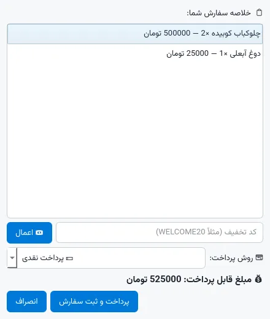
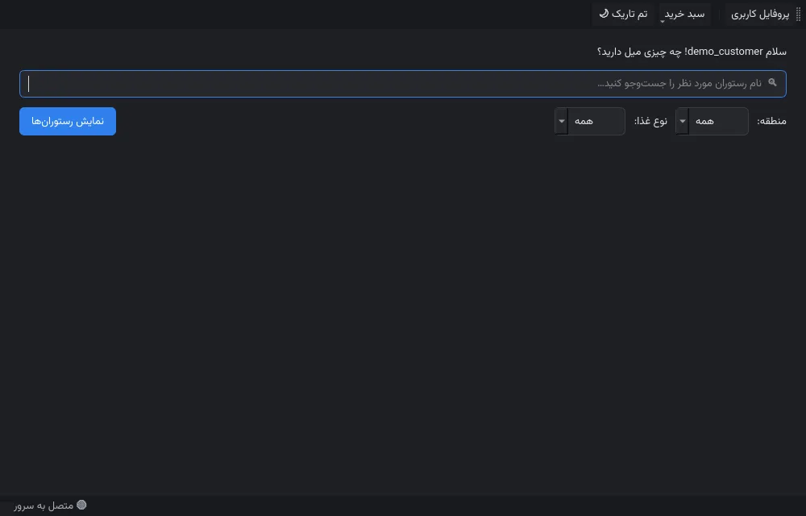
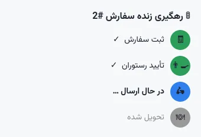
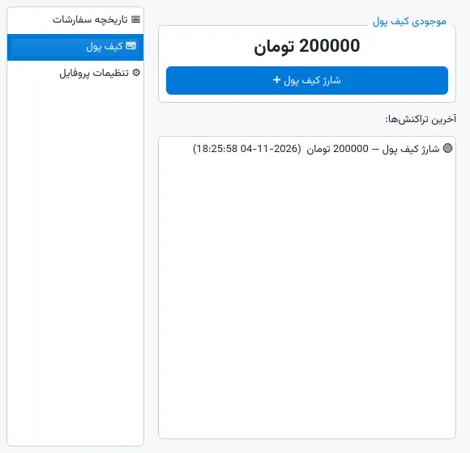
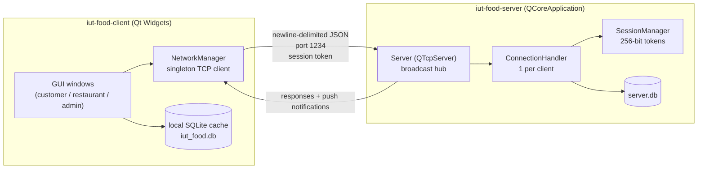
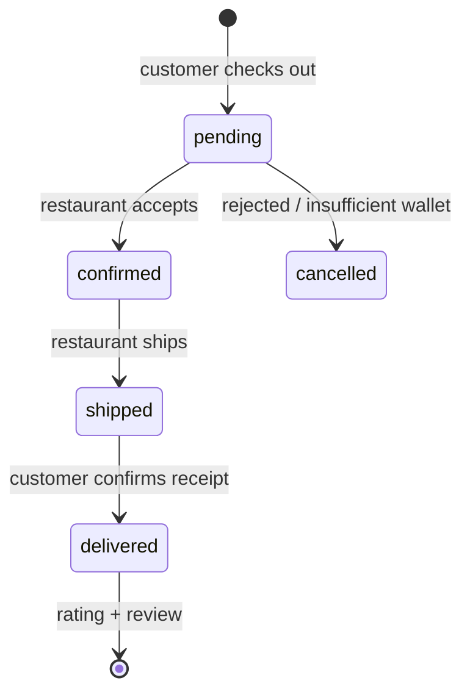
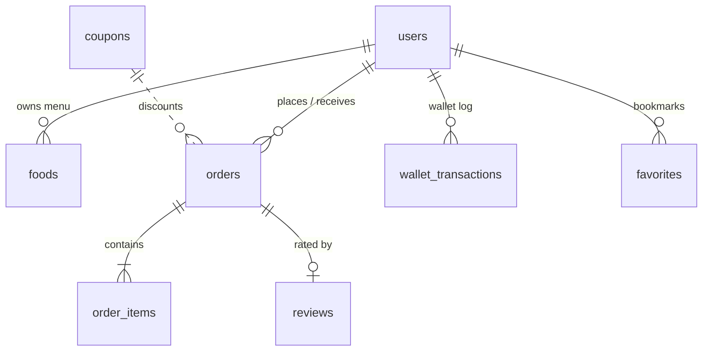
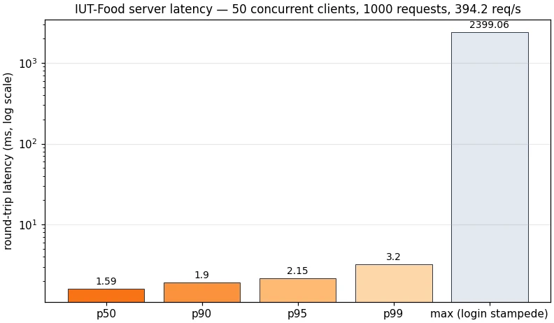

<div align="center">


# 🍔 IUT-Food

**A campus food-ordering system built with Qt / C++17 — client, TCP server and SQLite, fully working end-to-end.**

[](https://github.com/Abolfazlrwm/IUT_Food/actions/workflows/ci.yml)
[](https://github.com/Abolfazlrwm/IUT_Food/releases)


*فارسی? The UI is Persian — the docs below are in English. [پایین را ببینید 👇](#-پروژه)*

</div>

---

## ✨ What is this?

IUT-Food is a food-ordering platform for university students (built as a software-engineering
course project at Isfahan University of Technology). It ships as **two Qt applications**:

| App | What it does |
|---|---|
| **`iut-food-client`** (GUI) | Customers browse restaurants, order food, pay from a wallet, redeem coupons, track orders live and chat. Restaurant owners manage their profile, menu and incoming orders. Admins watch over users, coupons, orders and live reports. |
| **`iut-food-server`** (console) | A TCP server (newline-delimited JSON) that owns the remote database, authenticates logins, and **broadcasts order-status changes, chat messages and new-order events to every connected client in real time**. |

The client is offline-first: it keeps a local SQLite cache and degrades gracefully when the
server is not running, then syncs through the server whenever it is available.

## 🖼 Screenshots

| Launcher | Customer workspace |
|---|---|
|  |  |

| Menu with favorites | Checkout with coupon + wallet |
|---|---|
|  |  |

| 🌙 Dark mode | Live order tracking |
|---|---|
|  |  |

| Wallet page | Admin panel with coupon manager |
|---|---|
|  |  |

## 🚀 Features

### Ordering experience
- 👤 **Customer** — search & filter restaurants, browse menus, shopping cart, checkout,
  order history, delivery confirmation, star ratings with comments, live chat per order
- 💳 **Wallet** — top up a balance, pay orders from the wallet (transactional, atomic
  deduction, full transaction log), fall back to cash
- 🎟 **Coupon codes** — percent or fixed-amount discounts with minimum-order thresholds,
  usage limits and expiry; admins manage them, customers redeem them at checkout
- 🚦 **Live order tracking** — a real-time pipeline widget (`placed → confirmed → shipped
  → delivered`) that updates in place as the restaurant works on the order
- 🔄 **One-click reorder** — push a previous order's dishes back into the cart
- ⭐ **Favorites** — bookmark restaurants and filter the list down to them

### Platform
- 🏪 **Restaurant owner** — login/registration (admin-approved), profile editor,
  full menu CRUD, incoming-order dashboard, one-click *confirm → ship* transitions
- 🛡 **Admin** — credential-gated sign-in, user management (block / unblock / delete),
  restaurant approval workflow, order browser, coupon manager, **four live reports**
  (orders by status, revenue per restaurant, most active restaurants, average rating per
  restaurant) rendered with Qt Charts, and live server-health stats
- 🌙 **Dark & light themes** — full application-wide stylesheets, switched live from any
  window and persisted across restarts
- 🔌 **Real-time server push** — status changes, chat messages and new-order events are
  broadcast over TCP; every window of every process updates instantly
- 🔒 **TLS transport (opt-in)** — start the server with `--tls-cert/--tls-key` and the
  same newline-delimited JSON travels inside a standard TLS 1.2/1.3 channel; the client
  login dialog exposes a TLS switch (with self-signed consent for demos), and a full
  unit suite + CI smoke run verify the encrypted path
- 💾 **Offline-first client** — local SQLite cache; the app is fully usable without the server
- 📜 **Rotating file logging + graceful shutdown (v2.4)** — `--log-file/--log-level` with
  size rotation and level filtering, per-request timing lines, and a clean
  SIGTERM/docker-stop path that says goodbye to clients before exiting
- 🚄 **Tuned SQLite data layer (v2.4)** — WAL journal, `synchronous=NORMAL`, busy timeout
  and prepared-statement reuse cut tail latency by ~20-37% (see the performance section)
- 🌱 **Self-seeding demo data** — first launch creates restaurants, menus, orders, a review,
  wallet balance and coupons, so every screen has content immediately
- 🎨 **Bundled Vazirmatn typeface** + full right-to-left UI — Persian renders identically on
  Windows, Linux and macOS (no more broken Tahoma)
- 🔒 **Authenticated protocol** — every command except `login` requires a server-minted
  256-bit session token (30-minute sliding idle lifetime, `logout`, per-session role);
  wallets, orders, profiles and menus are ownership-checked against the session, so a
  client-sent `user_id` is never trusted
- 🔑 **Hardened auth** — salted PBKDF2-HMAC-SHA256 password hashing with a transparent
  one-time upgrade of pre-v2.1 unsalted hashes; per-connection rate limiting (token bucket)
  and a 64 KiB message cap on the wire
- 💾 **Parameterised SQL everywhere**, canonical order-state machine, smooth schema
  migration (v1/v2 databases upgrade in place)

## 🏗 Architecture



**Order lifecycle** (canonical states, shown in Persian in the UI):



The full JSON command reference lives in [`docs/PROTOCOL.md`](docs/PROTOCOL.md).

## 🗄 Database

Nine tables — `users` (customers, restaurants and admins in one table with a `role`
column + wallet `balance`), `foods`, `orders` (with discount/coupon/payment columns),
`order_items` (with a denormalised food-name snapshot so history survives menu edits),
`restaurants` (server-sync cache), `reviews`, plus the v2 tables `wallet_transactions`,
`coupons` and `favorites`:



## 📦 Build

### Prerequisites

- **Qt 5.15+ or Qt 6.2+** with the modules `Widgets`, `Network`, `Sql`, `Charts`
  - WebP icons require the **Qt Image Formats** module (bundled in standard Qt installs)
- **CMake ≥ 3.16** (recommended) *or* qmake (any Qt Creator version)

### Option A — CMake (recommended)

```bash
git clone https://github.com/Abolfazlrwm/IUT_Food.git
cd IUT-Food
cmake -B build -DCMAKE_BUILD_TYPE=Release
cmake --build build -j

# run the server (terminal 1)
./build/iut-food-server
# run the client (terminal 2)
./build/iut-food-client
```

### Option B — qmake / Qt Creator

Open `IUT-Food.pro` in Qt Creator → *Configure Project* → build & run. It builds both
`src/client/client.pro` and `src/server/server.pro`.

> **Windows:** run the server from a terminal (`iut-food-server.exe`), then the client.
> Both executables must be able to reach `127.0.0.1:1234`.

### Option C — Docker (server)

```bash
docker compose up          # builds the image and serves on 1234 with a named volume
```

The image is a two-stage build (distro Qt 6 toolchain → slim runtime with only the
server and its Qt libraries) and is built *and* smoke-tested inside CI on every push.

### Option D — ready-made Windows build

Every release ships a portable Windows x64 zip (client, server and the Qt DLLs they
need — unzip and run, no installer). Grab it from
[Releases](https://github.com/Abolfazlrwm/IUT_Food/releases); each artifact comes with
a SHA-256 checksum. Linux users should prefer the Docker route above.

## ▶ Quick tour (2 minutes)

1. Start `iut-food-server` (keeps running — it prints every connection).
2. Start `iut-food-client`.
3. **سفارش غذا** → log in with `demo_customer` / `123456`.
4. Show restaurants → pick **پیتزا پاردیس** → add dishes → cart → checkout.
5. At checkout type coupon **`WELCOME20`** → watch 20 % come off, then pay from the wallet 🪙
6. A live **tracking window** opens — start a **second** client instance →
   **پنل رستوران** → log in with `pizza_pardis` / `123456` → confirm & ship the order →
   watch the tracker jump steps in the first window instantly. Say hi in the chat tab 🎉
7. Profile → **کیف پول** → top up, check the transaction log; open an old order → **🔄 سفارش دوباره**.
8. **پنل مدیریت** (any client) → manage users, create coupons, render the live charts.

### Demo accounts (seeded automatically on first run)

| Role | Username | Password | Extra |
|---|---|---|---|
| Admin | `admin` | `admin123` | coupon manager |
| Customer | `demo_customer` | `123456` | wallet pre-charged with 200,000 تومان |
| Restaurants | `kebab_hafez`, `pizza_pardis`, `burger_bam` | `123456` | |

Demo coupons: `WELCOME20` (20 % off, min 100,000) and `IUT50` (50,000 تومان off, min 250,000).

### Server options

```
iut-food-server [--port 1234] [--db server.db]
iut-food-server --tls-cert certs/server.crt --tls-key certs/server.key   # TLS mode
iut-food-server --log-file logs/server.log --log-level info              # v2.4 logging
```

TLS demo in one line: `sh scripts/generate_certs.sh` creates a self-signed
localhost certificate, the server then accepts encrypted connections on the
same port, and the client login dialog gets a **رمزگذاری TLS** switch
(see [PROTOCOL.md §12](docs/PROTOCOL.md)).

Logging (v2.4): without a `--log-file` the server logs to stderr as before;
with one, every line is mirrored into a size-rotated file (5 MiB per generation, 3 generations kept as `server.log.1`, `server.log.2`).  Levels:
`debug` (per-request lines with durations), `info` (connections, handshakes,
shutdown), `warning` (rate-limit rejections, oversize frames), `error`.  A
`SIGTERM` / Ctrl+C / `docker stop` now ends the process gracefully: the
listener closes, connected clients receive a final `server_shutdown`
note, and the exit code stays 0.

## 🧪 Tests

### Unit tests — nine Qt Test suites, 52 cases

The business rules are covered by Qt Test suites that run against a scratch SQLite
database (and one suite against the official RFC vectors):

| Suite | Covers |
|---|---|
| `passwordhasher_tests` | PBKDF2-HMAC-SHA256 against the **official RFC vectors**, salt uniqueness, tampering rejection |
| `ratelimiter_tests` | token-bucket burst, refill, cap and flood shedding |
| `session_tests` | 256-bit token minting, sliding expiry, logout revocation, sweeping, store cap |
| `wallet_tests` | atomic payment, overdraw rejection, transaction audit log |
| `coupon_tests` | percent/amount math, min-order, expiry, usage limits |
| `orders_tests` | canonical status machine, item snapshots, cancel path |
| `users_tests` | registration/login, blocking, **transparent legacy-hash migration** |
| `tls_tests` | TLS handshake against the bundled certificate, encrypted login/wallet round-trip, chat broadcast over TLS, plain-text clients rejected |
| `logger_tests` | level filtering, size-based rotation generations, stderr-only fallback, level parser |

```bash
ctest --test-dir build --output-on-failure    # 9 suites, 52 cases
```

### End-to-end smoke test — 52 protocol checks

`scripts/smoke_test.py` speaks the wire protocol against a running server and exercises
every command — login and session tokens, filters, menu, ordering, status pushes, chat
broadcast, reviews, wallet, coupons and user administration — **plus a dedicated
security section**: unauthenticated/forged tokens, foreign wallets and profiles, the
admin role matrix, server stats and logout revocation.

```bash
./build/iut-food-server &        # start the server
python3 scripts/smoke_test.py    # ✅ 52 checks

# the same suite over an encrypted channel:
./build/iut-food-server --tls-cert certs/server.crt --tls-key certs/server.key &
python3 scripts/smoke_test.py --tls
```

### Performance

`scripts/benchmark.py` drives 50 concurrent client connections and records every
round trip (scratch database, read-mostly workload).  Since v2.4 the same run
is kept for the previous release in `docs/benchmark-results-baseline.json`, so
the chart shows the data-layer work instead of a single snapshot:

| Requests | Throughput | p50 | p90 | p95 | p99 |
|---|---|---|---|---|---|
| 1000 | 406 req/s | 1.1 ms | 1.6 ms | 1.9 ms | 2.8 ms |



The v2.3 baseline on the same sandbox: 400 req/s with p50 1.7 ms and p99 3.5 ms —
v2.4 (WAL journal, `synchronous=NORMAL`, prepared-statement reuse on the hot read
paths) keeps the throughput ceiling of the 2-core event loop while cutting **p50
by ~38% and p99 by ~21%**.  A paced 10,000-request run (`--pacing 15` under the
rate limiter) shows the same shape: p50 0.37 ms vs 0.83 ms and p99 1.75 ms vs 2.43 ms at
~633 req/s on both builds.

Logins intentionally cost one PBKDF2 derivation on the server (~30 ms each); the
`max` tail in the chart is the initial 50-client login stampede draining the
single-threaded event loop.

The GitHub Actions workflow builds both targets on **Ubuntu and Windows** on every push,
runs `ctest` and the smoke test on both, runs the **whole smoke suite a second time over
TLS** on Ubuntu, and builds + smoke-tests the Docker image in its own job. A separate
release workflow attaches portable Windows and Linux artifacts to every `v*` tag.

## 📁 Project structure

```
IUT-Food/
├── src/
│   ├── common/          # shared data layer (SQLite, models, status machine, demo seed)
│   ├── client/          # Qt Widgets GUI (customer, restaurant, admin) + TCP client
│   └── server/          # console TCP server (broadcasts + JSON command dispatch)
├── resources/           # qrc: WebP icons + bundled Vazirmatn fonts
├── fonts/               # Vazirmatn (SIL OFL 1.1)
├── docs/
│   ├── PROTOCOL.md      # full JSON protocol reference
│   ├── images/          # hero banner (WebP)
│   └── screenshots/     # real app screenshots (WebP)
├── scripts/
│   ├── smoke_test.py         # end-to-end protocol test (52 checks)
│   ├── benchmark.py          # latency / throughput harness
│   └── screenshot_driver.cpp # offscreen capture driver for the docs
├── tests/               # seven Qt Test suites (run with ctest)
├── Dockerfile           # two-stage server image (+ docker-compose.yml)
├── .github/workflows/   # CI (Ubuntu + Windows build, tests, docker) + release pipeline
└── CMakeLists.txt       # two targets: iut-food-client, iut-food-server
```

## 🛣 Roadmap

- [x] Wallet & coupon system (v2.0)
- [x] Live order tracking pipeline (v2.0)
- [x] Dark/light themes (v2.0)
- [x] Salted password hashing (PBKDF2-HMAC-SHA256) with transparent legacy migration (v2.1)
- [x] Unit tests, Docker image and latency benchmark (v2.1)
- [x] Session-token authentication with role & ownership enforcement (v2.2)
- [x] Windows CI build + automated release artifacts (v2.2)
- [x] TLS transport for remote deployments (v2.3)
- [x] Rotating file logger, graceful shutdown and WAL-based database tuning (v2.4)
- [ ] Per-order chat rooms instead of global broadcast
- [ ] WebSocket transport option
- [ ] Telegram bot for order notifications

## 🤝 Contributing

Issues and PRs are welcome — this is a student project that is meant to be poked at.
See [CONTRIBUTING.md](CONTRIBUTING.md); please keep the build green (CI runs the smoke
test) and match the existing code style (4 spaces, `QStringLiteral`, documented classes).

## 📜 License

- Project code: **MIT** — see [LICENSE](LICENSE).
- [Vazirmatn font](https://github.com/rastikerdar/vazirmatn): SIL Open Font License 1.1.

---

<div align="center">

## 🍔 پروژه

**IUT-Food** یک سامانه سفارش غذای دانشگاهی است که با Qt و C++17 ساخته شده:
کلاینت گرافیکی برای مشتری، رستوران و مدیر + سرور TCP با قابلیت push لحظه‌ای وضعیت سفارش‌ها و چت.
در نسخه ۲، **کیف پول، کدهای تخفیف، رهگیری زنده سفارش، حالت تاریک و علاقه‌مندی‌ها** هم اضافه شده است.
رابط کاربری کاملاً فارسی و راست‌به‌چپ است و داده‌های نمونه در اولین اجرا ساخته می‌شوند.

⭐ اگر این پروژه برایتان مفید بود، یک ستاره بزنید!

</div>
