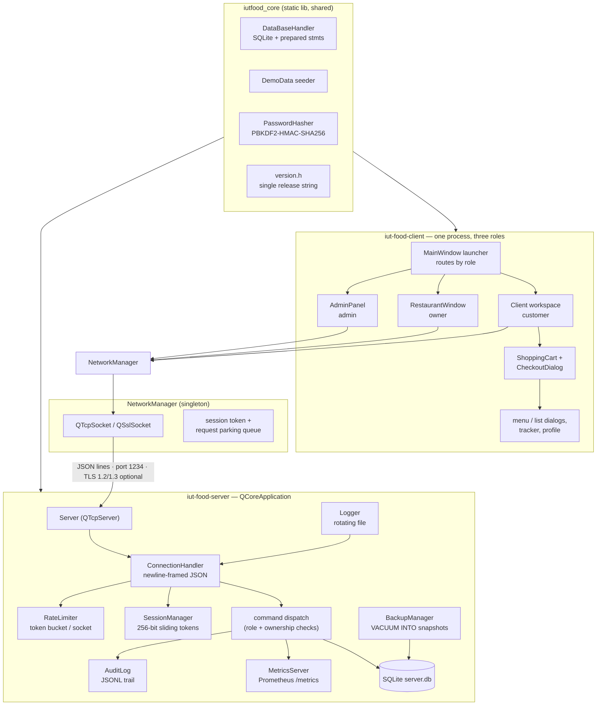

# IUT-Food architecture

A map of how the two applications are built, how a request travels from
a button click to a database row, and which security boundaries sit in
between.  The wire itself is specified in [PROTOCOL.md](PROTOCOL.md);
this document explains the *why* behind the modules.

## Bird's-eye view

## Modules and responsibilities

| Module | Lives in | Responsibility |
|---|---|---|
| `DataBaseHandler` | `src/common` | The only place that speaks SQL. Owns the SQLite connection, schema creation and in-place migrations (v1/v2), prepared-statement cache, WAL tuning. |
| `DemoData` | `src/common` | Seeds restaurants, menus, wallet balances, coupons and the three demo accounts — only when the database is fresh; `--no-demo-data` skips it. |
| `PasswordHasher` | `src/common` | Salted PBKDF2-HMAC-SHA256; transparent one-time upgrade of legacy unsalted hashes at login. |
| `version.h` | `src/common` | The single release string; CMake parses it, every binary and the About dialog read it — one line to bump a release. |
| `NetworkManager` | `src/client` | Singleton TCP client. Newline-delimited JSON, TLS option, session-token attachment, and a parking queue so panels can fire queries before the login round-trip finishes. Since v2.8 it also exposes the server-announced release. |
| `Server` / `ConnectionHandler` | `src/server` | `QTcpServer` accepts; one handler per connection reads frames, rate-limits, enforces the session, dispatches commands and pushes broadcasts (order status, chat, shutdown). |
| `SessionManager` | `src/server` | 256-bit random tokens, 30-minute sliding idle lifetime, role per session, logout revocation, store cap. |
| `RateLimiter` | `src/server` | Token bucket per connection; bursts shed with a `rate_limited` error before they reach the dispatch. |
| `MetricsServer` | `src/server` | One-shot HTTP/1.0 responder on `--metrics-port`; the same counters the admin health tab reads. |
| `BackupManager` / `AuditLog` / `Logger` | `src/server` | Rolling `VACUUM INTO` snapshots, JSONL security trail, size-rotated log file — all owned by the server event loop. |
| GUI windows | `src/client` | Launcher, customer workspace, restaurant dashboard, admin console. The client is offline-first: every mutation hits the local SQLite first and the server is informed / queried opportunistically. |

## Life of a request

1. **Click** — a dialog calls `NetworkManager::sendJson({"command": "get_menu", ...})`.
2. **Session** — the manager appends the session token (or parks the
   request in `m_pendingBeforeSession` if the login round-trip is still
   in flight; the queue is flushed the moment the token arrives).
3. **Wire** — compact JSON + `\n` over `QTcpSocket`, or `QSslSocket`
   when the login dialog's TLS switch was ticked.
4. **Gate** — the server's `ConnectionHandler` reads a frame, applies
   the rate limiter and the 64 KiB cap, checks the session token and
   its role, then dispatches. Ownership is checked server-side: a
   client-sent `user_id` is never trusted.
5. **Data** — `DataBaseHandler` runs a prepared statement; wallet moves
   run inside a transaction (payment → order row, or nothing).
6. **Answer + push** — the reply goes back on the same socket;
   state changes are additionally broadcast to every other session
   (`order_status_update_notification`, `new_chat_message_notification`),
   which is what makes the live tracker move in the customer's window.
7. **Client lands** — `NetworkManager` re-emits typed signals
   (`restaurantsReceived`, `orderStatusUpdated`, `operationResult`,
   `serverVersionReceived`); windows update in place, no polling.

## Security model

| Boundary | Mechanism |
|---|---|
| Passwords at rest | salted PBKDF2-HMAC-SHA256 (RFC-vector-tested), transparent legacy migration |
| Sessions | 256-bit tokens, sliding 30-min expiry, revocation on logout / disconnect |
| Authorization | role per session + ownership checks in every command; admin commands gated separately |
| Transport | plaintext TCP for the trusted campus LAN, opt-in TLS 1.2/1.3 (`--tls-cert/--tls-key`), self-signed consent only for demos |
| Abuse | per-connection token-bucket rate limiting, 64 KiB frame cap, login audit failures |
| Forensics | JSONL audit trail of logins, moderation, wallet moves and placed orders |
| Ops | parameterised SQL only; canonical order-state machine; WAL + `synchronous=NORMAL` |

## Threading model

Deliberately single-threaded: one Qt event loop per process, all I/O
asynchronous (sockets, `QTimer`-driven backups).  No locks exist in the
codebase because no state is shared across threads; the ~400 req/s
ceiling of the 2-core benchmark is the cost of that simplicity, and the
PBKDF2 logins (~30 ms each) are the intentional slow path.  The
database is opened in `WAL` mode so the demo's two processes (client
cache + server) never block each other.

## Build layout

- `CMakeLists.txt` builds `iutfood_core` (static), `iutfood_client`
  (GUI app) and `iut-food-server` (console app); `CMakePresets.json`
  adds `linux-release`, `linux-debug`, `linux-asan` (ASan+UBSan, the CI
  sanitizer leg) and `windows-release`.
- `IUT-Food.pro` / `client.pro` / `server.pro` keep the qmake/Qt Creator
  path alive for students on course machines.
- `scripts/smoke_test.py` (53 protocol checks), `tests/` (14 Qt Test
  suites, 73 cases) and the Docker image healthcheck all verify the
  same contract from three different directions — CI runs all of them
  on every push.
- `scripts/run_demo.sh` is the fastest loop: build-if-needed, seed,
  healthcheck-wait, launch — see [DEMO.md](DEMO.md).
